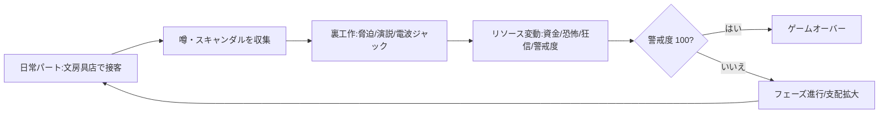

---

title: コアゲームループ（コアループ)
description: プレイヤーが繰り返す行動のサイクル。日常パート、裏工作、フィードバックからフェーズ進行まで。
status: draft
version: "0.1"
category: design
tags:
- game-loop
- core-loop
- design
  traces_to:
- docs/design/resources.md
- docs/design/mechanics.md
  implemented_by:
- src/core/GameEngine.ts
- src/core/actions/*.ts
  verified_by:
- tests/integration/game-loop.test.ts

---

# コアゲームループ

## ── ループの説明

1. **日常パート（表の顔）：** 店に来る子供や主婦と接客し、 rumors を収集して警戒度を低下させ、資金獲得や評判構築をする
2. **裏工作（裏の顔）：** 収集した噂や弱みを使って、`runShop`, `spreadRumor`, `intimidate` などの操作を実行する
3. **リソース変動：** Balanceリソースクラスが各操作の結果を扱い、`Resources` と `GameState` を変更し、イベントを発火する
4. **警戒度評価：** 恐怖の濫用が警戒度閾値を超えると Game Overになる
5. **フェーズ昇格：** 条件を満たすと次のフェーズに移動し、次の舞台（Phase 2-4）のロジックが有効になる
6. **繰り返し：** 上記のサイクルが勝利まで繰り返される

## ── コアループのコンポーネント

| セグメント   | 責任                                                   | 主要ファイル                                | 主要クラス/関数                                                                        |
| ------------ | ------------------------------------------------------ | ------------------------------------------- | -------------------------------------------------------------------------------------- |
| 日常パート   | 文房具店で接客、噂収集、警戒度低下                     | `src/phaser/scenes/StreetScene.ts` (UI統合) | `日常パート` コマンド、`Phaser` Canvas内のUIレンダリング、`日常パート` イベントを発行  |
| 裏工作       | 恐怖/狂信/資金操作、ポリシー・裏工作                   | `src/core/actions/*.ts`                     | `intimidate`, `runShop`, `spreadRumor` など、純粋関数 `ActionResult` を返す            |
| リソース変動 | `Resources` + `GameState` を変更、`EventSystem` を発行 | `src/core/GameEngine.ts`                    | `GameEngine.execute(action, context)`, `Resources`, `GameState` を変更、イベントを発行 |
| 警戒度評価   | `suspect` をチェックし、100 なら Game Overにする       | `src/core/GameState.ts`                     | `if (suspect >= 100) setGameOver()`                                                    |
| フェーズ昇格 | `フェーズ昇格` 閾値を確認し、次の Phase に遷移         | `src/balance/Thresholds.ts`                 | `if (条件) GameState.setPhase(next)`                                                   |

> **注：** このループ図はゲーム全体の設計を簡潔に表現。実際のコードは `src/core/ -> actions/ -> GameEngine.ts` で実装されます。

> **UI統合:** ステータスバー・コマンドパネル・ログコンソールは `src/phaser/scenes/` 内のPhaser Canvas UIで管理される（詳細は [[docs/design/ui-integration]]）。イベント発行からCanvas内UI更新への経路が確立された。
